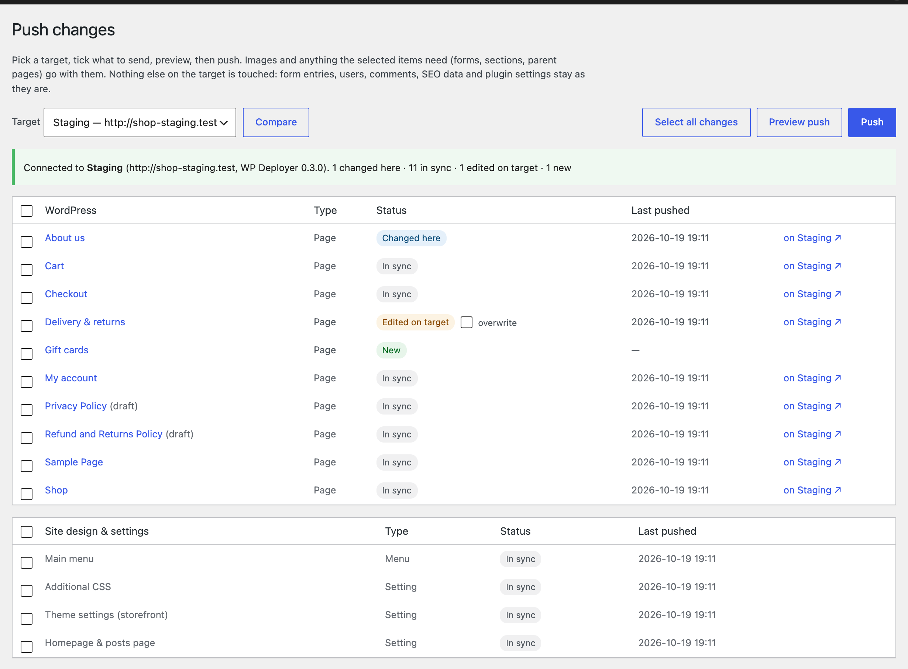
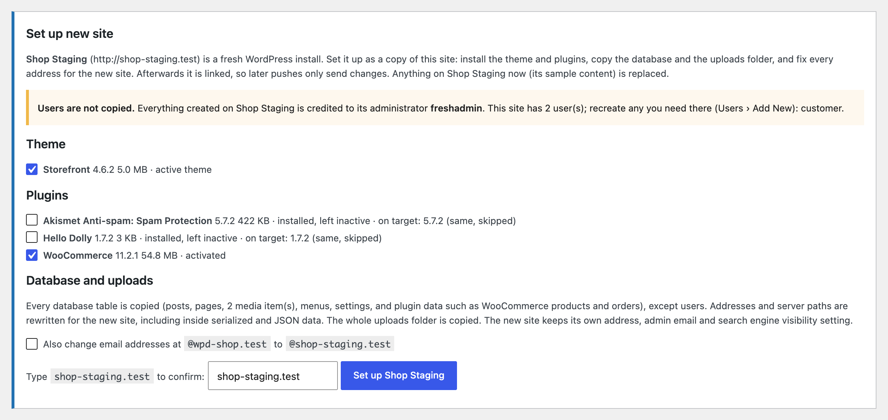
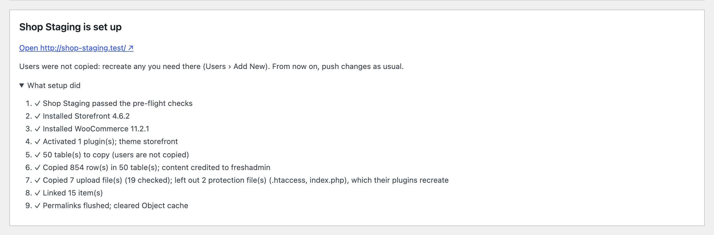
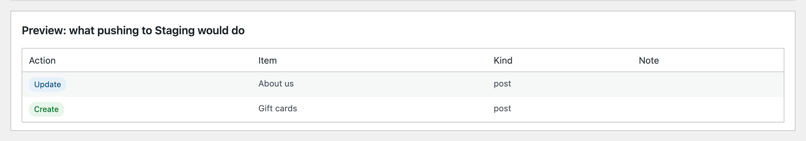
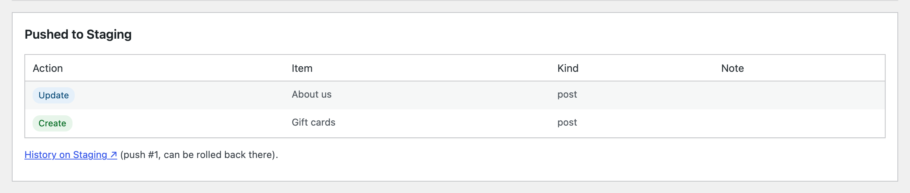
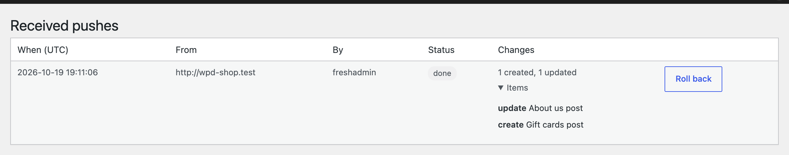
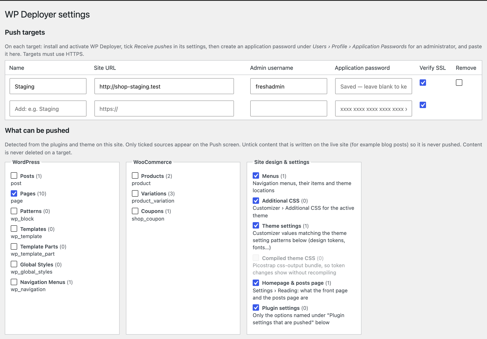

# WP Deployer

Push content and design changes from one WordPress site to another (local → staging → production) item by item, without replacing the receiving site's database. Form entries, users, comments, SEO data and plugin activation on the receiving site are left alone.



## What it pushes

Sources are detected from the plugins and theme on the site and switched on or off in **WP Deployer › Settings**:

- **Post types**, grouped by the plugin that registered them: pages, posts, LiveCanvas partials / dynamic templates / sections / blocks, Forminator forms, and so on. Pages, LiveCanvas types and Forminator forms are on by default. Posts are off, so blog posts written on the live site are never touched.
- **Menus**: items and theme locations.
- **Additional CSS**, **theme settings** (Customizer theme mods by name pattern, default `SCSSvar_*`, `picostrap_*`, font objects) and the **compiled Picostrap CSS bundle**. Picostrap compiles SCSS in the browser, so the bundle is sent with the tokens.
- **Homepage & posts page** (Settings › Reading).
- **Plugin settings**: only the options you name (default `lc_settings`, which holds the LiveCanvas header, footer and dynamic templates switches). Site URL and name, active plugins, user roles and anything that looks like a key, token, secret or password are never pushed.

Images and upload files referenced by pushed items travel with them, together with every generated size. Posts the selection depends on (a form embedded in a page, an `lc_get_post` section, a parent page) are added automatically when the target doesn't have them.

Nothing is ever deleted on a target.

## Set up a new site

Turn a fresh WordPress install into a full copy of this site, WooCommerce and other plugin data included, instead of using a migration plugin.



1. Install WordPress on the new URL and install WP Deployer there.
2. On the new site, tick **Receive pushes** and create an application password.
3. Add it as a target here and open **Push**. Because the target is a fresh install (no pushes yet, only WordPress's sample content, an empty media library), a **Set up new site** panel appears.
4. Untick any theme or plugin you don't want installed, type the target's domain to confirm, and run it.

Setup runs one step at a time, with progress on screen. Long steps are split into 20-second rounds, so no single request can time out.

1. **Pre-flight checks.** The target checks that it can install code and that its PHP and WordPress versions meet the plugins' requirements. It also checks disk space against the size of the copy, PHP memory and time limits, that its folders are writable, and its database version. A failed check stops setup before anything changes.
2. **Theme and plugins.** They are installed with WordPress's own installer, in 4 MB chunks. Ones already there at the same version are skipped. The plugins active here are activated, which runs their install routines.
3. **Database.** Every table with this site's prefix is copied: core and plugin tables alike, so WooCommerce products, orders, coupons, shipping and tax, form plugins and so on all come across. The exceptions are **users and usermeta**, and WP Deployer's own tables.
   - Each table is built under a temporary name, then all of them are swapped in with one `RENAME`.
   - Table prefixes may differ between the sites.
   - The target keeps its own identity: site URL, admin email, search engine visibility, salts and WP Deployer settings.
4. **Uploads.** The whole uploads folder is copied. Executable files (`.php`, `.htaccess`…) are never copied; plugins recreate their own.
5. **Link.** Every item is recorded as pushed, so the next Compare shows *In sync*.
6. **Finish.**
   - Installs the language pack, including plugin and theme translations.
   - Switches off plugins known to break after a move, as Duplicator does: WP Rocket, Jetpack, Popup Maker, WPBakery, iThemes Security, reCAPTCHA plugins, and SSL-forcing plugins if the new site isn't on HTTPS. The screen lists each one, so you can reactivate it.
   - Flushes permalinks and clears caches.



**Addresses and paths** are rewritten by WPD_Replace, in every stored form:

- `https://`, `http://` and protocol-relative `//`, with or without `www.`
- JSON-escaped and URL-encoded
- inside serialized data (walked with its own lengths and rewritten without unserializing, so stored objects survive) and inside base64
- server paths (`ABSPATH`, `wp-content`, uploads)
- optionally, email addresses at the old domain

Matching stops at a boundary, so `site.test` never matches inside `site.testing.com`, but it still matches at the end of a sentence.

**Users are not copied.** Posts are credited to the target's administrator, and the panel lists the users to recreate. Orders keep their customer details, but registered customers' accounts must be recreated.

**Not copied:** must-use plugins (LiveCanvas recreates its own), `wp-config.php`, and other sites' tables in the same database.

The target refuses setup if:

- it isn't fresh;
- the typed domain doesn't match;
- it can't install code (`DISALLOW_FILE_MODS`, or a host that needs FTP credentials);
- it's a multisite network.

## Pushing changes

1. **Compare** shows every enabled item and how it stands against the target (screenshot at the top).
2. **Select all changes** ticks what's new or changed here. Items edited on the target are left unticked, and need **overwrite** ticked to replace them.
3. **Preview push** shows exactly what would happen.

   

4. **Push** asks for a second click to confirm, then reports what was done.

   

Every push is listed on the target under **WP Deployer › History**, where it can be rolled back:



**Settings** lists what can be pushed, grouped by the plugin that registered it:



## How matching works## How matching works

Each pushed object gets a UUID (`_wpd_uuid` post/term meta). On the first push the target matches by post type + slug, attachment file path or menu slug, and adopts the UUID. After that, matching is by UUID.

IDs and URLs inside content are made portable on the way out and resolved on arrival:

- site URL and uploads URL, including JSON-escaped forms
- `wp-image-N` classes and `id="attachment_N"`
- ID attributes of known shortcodes: Forminator, `lc_get_post`, `gallery`. Extend with the `wpd_id_shortcodes` filter.
- block comment attributes `id`, `ref`, `mediaId` and `featuredImage`
- ID meta keys: `_thumbnail_id`. Extend with the `wpd_id_meta_keys` filter.

## Safety

- After every push (and rollback) the target clears its caches: the object cache, plus LiteSpeed, WP Rocket, W3 Total Cache, WP Super Cache, WP Fastest Cache, SiteGround, Breeze, Autoptimize, WP-Optimize, Hummingbird, Nginx Helper, Cache Enabler, Cachify, Comet Cache, Cloudflare Super Page Cache, WP Engine, GoDaddy and Elementor CSS. Hook more with `wpd_purge_caches`.
- Files are uploaded in time-boxed rounds (and large files in chunks) before the items are applied, so big pushes don't time out.

- **Preview** shows exactly what will be created, updated, left unchanged or skipped.
- The target remembers what it last received. Each item shows *New*, *Changed here*, *In sync*, *Edited on target* or *Changed on both*. Items edited on the target are skipped unless you tick **overwrite** for that item.
- **Protected meta** (default: Yoast, Rank Math, AIOSEO, SEOPress, Genesis, Forminator's submission counter) is never sent and never overwritten. The target only touches meta keys the sender has pushed before, so meta added by the target's own plugins is left alone.
- Every push is recorded on the target with a snapshot of everything it changed. **WP Deployer › History** on the target can roll a push back, which also deletes what it created. A push that fails halfway is rolled back automatically. Upload files a push overwrote are not restored.

## Setup

1. Install and activate the plugin on both sites.
2. On the **target** (staging/production):
   - **Settings › Receive pushes** → tick, save.
   - Create an application password for an administrator under **Users › Profile › Application Passwords**.
3. On the **sending** site (local):
   - **Settings › Push targets** → add the target's URL, the admin username and the application password. The password is stored encrypted with this site's `AUTH_KEY` salt.
4. **WP Deployer › Push** → pick the target → *Compare* → tick items → *Preview push* → *Push*.

The target must use HTTPS, which WordPress requires for application passwords. If the host strips the `Authorization` header (some Apache + FastCGI setups), the plugin also sends credentials as `X-WPD-Auth`, and the receiving side accepts either.

## Updates

Sites update WP Deployer from this repo's GitHub releases, with an **Update** button in Dashboard › Updates and on the Plugins screen, auto-updates included. No token is needed.

A token is optional. Add one if the repo is ever made private, or if a server shares its IP with many sites and hits GitHub's limit of 60 anonymous API requests an hour. Create a fine-grained token limited to this repo with *Contents: Read-only*, then either add it to `wp-config.php`:

```php
define( 'WPD_GITHUB_TOKEN', 'github_pat_…' );
```

or paste it in **WP Deployer › Settings › Plugin updates**, where it's stored encrypted.

WordPress checks every 12 hours, and the plugin caches GitHub's answer for 6. **Dashboard › Updates › Check again** checks immediately.

**Development copies:** a copy of the plugin that is a git checkout (has a `.git` folder) is never offered updates, so WordPress can't replace it with a zip.

## Releasing

1. Bump the version in `wp-deployer.php` (both the `Version:` header and `WPD_VERSION`) and commit.
2. Tag and push:
   ```
   git tag -a v0.3.0 -m "WP Deployer 0.3.0" -m "Release notes…"
   git push origin main v0.3.0
   ```

The Release workflow checks the tag matches the plugin version and builds `wp-deployer-0.3.0.zip`. It then publishes the release, using the tag message as the notes. Sites offer the update from there.

## Not covered (yet)

- Deleting items, and pushing in the other direction (pull)
- Theme and plugin **code**: deploy those files separately (rsync/Deployer)
- Users, comments, form entries, WooCommerce data: deliberately never synced

## Licence

GPL-2.0-or-later. See [LICENSE](LICENSE).
